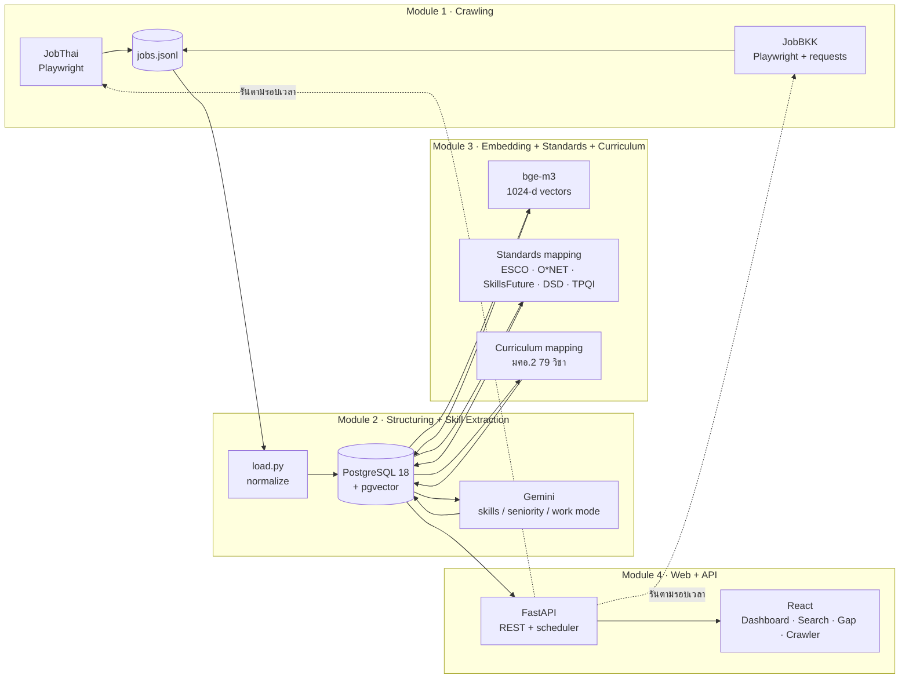

# AI Readiness — Automated Continuous Job Crawling to AI Readiness Database & Curriculum Gap Intelligence System

โครงงานวิศวกรรมคอมพิวเตอร์ มหาวิทยาลัยกาฬสินธุ์

ระบบดึงประกาศงานสายคอมพิวเตอร์/ไอที และวิศวกรรมไฟฟ้า/อิเล็กทรอนิกส์ จาก **JobThai** และ **JobBKK** อย่างต่อเนื่อง
สกัดทักษะด้วย LLM เก็บเป็นฐานข้อมูลพร้อมเวกเตอร์ (pgvector) จับคู่กับมาตรฐานทักษะสากล/ไทย
แล้ววิเคราะห์ช่องว่างระหว่าง **ความต้องการของตลาดแรงงาน** กับ **หลักสูตรวิศวกรรมคอมพิวเตอร์ (มคอ.2)**

## ภาพรวมระบบ



| Module | หน้าที่ | โฟลเดอร์ |
| --- | --- | --- |
| 1 | ดึงประกาศแบบสุภาพ (robots.txt, หน่วงเวลาสุ่ม, ชะลอเองเมื่อเว็บตอบ 429/5xx) ดึงเฉพาะงานใหม่ + งานที่ถูกอัปเดต | `scrapers/jobthai`, `scrapers/jobbkk` |
| 2 | นำเข้า PostgreSQL (ตัดซ้ำด้วย `url_hash`) · สกัดทักษะ ระดับตำแหน่ง รูปแบบการทำงานด้วย Gemini | `pipeline/load.py`, `pipeline/extractor/` |
| 3 | Embedding ด้วย BAAI/bge-m3 · จับคู่ทักษะกับมาตรฐาน 5 ชุด · จับคู่ทักษะกับรายวิชาในหลักสูตร | `pipeline/extractor/` |
| 4 | REST API + เว็บ: ภาพรวมตลาดแรงงาน, ค้นหางานด้วยความหมาย, Gap Analysis หลักสูตร, ควบคุม Crawler อัตโนมัติ | `backend/`, `frontend/` |

รายละเอียด Module 4 (API, หน้าเว็บ, สูตร Gap Analysis, ระบบตั้งเวลา): [docs/MODULE4.md](docs/MODULE4.md)

## โครงสร้าง repo
```
backend/            FastAPI (app/), สคริปต์ (scripts/), เทสต์ (tests/)
frontend/           React 18 + TypeScript + Vite + Tailwind
pipeline/           Module 2–3: load.py, adapters.py, extractor/ (Gemini, embedding, มาตรฐาน, หลักสูตร)
scrapers/jobthai/   Module 1: JobThai
scrapers/jobbkk/    Module 1: JobBKK
database/           วิธีติดตั้ง SQL dump (ตัวไฟล์อยู่ใน GitHub Releases)
docs/               เอกสารประกอบ
start.bat           เปิดทั้งระบบ (API + เว็บ + ตัวตั้งเวลา) ที่ http://localhost:8000
share-online.bat    เปิดให้คนอื่นเข้าชมผ่านอินเทอร์เน็ต (Cloudflare Quick Tunnel)
docker-compose.yml  เว็บ + API + ฐานข้อมูล ใน Docker
```

## ชุดข้อมูล
`jobmarket.sql.gz` ใน **Releases** — ประกาศงานมากกว่า 3,000 รายการ พร้อมทักษะ เวกเตอร์ 1024 มิติ (pgvector) การจับคู่มาตรฐาน และการจับคู่หลักสูตร
ข้อมูลติดต่อถูกลบออกแล้วตาม PDPA — รายละเอียดใน [database/README.md](database/README.md)

## ติดตั้งแบบเร็ว: Docker (ดูเว็บ + ค้นหา + Gap Analysis)
```bash
git clone <repo-url> ai-readiness && cd ai-readiness
# ดาวน์โหลด jobmarket.sql.gz จาก Releases -> วางใน database/
cp .env.example .env          # ตั้ง DB_PASSWORD, ADMIN_PASSWORD, JWT_SECRET
docker compose up -d --build  # เปิดครั้งแรกใช้เวลาหลายนาที (restore ฐานข้อมูล + โหลดโมเดล bge-m3 ~2 GB)
```
เปิด http://localhost:8080 · API docs http://localhost:8000/docs
ใน Docker ไม่มีส่วนดึงข้อมูล (Playwright + Gemini) — ใช้การติดตั้งแบบเต็มด้านล่าง

## ติดตั้งแบบเต็มบน Windows (รวมดึงข้อมูลอัตโนมัติ)
**ต้องมี:** Windows 10/11 · PostgreSQL 18 + [pgvector](https://github.com/pgvector/pgvector#windows) · Python 3.11+ · Node.js 18+ ·
Gemini API key (ใช้สกัดทักษะงานใหม่) · การ์ดจอ NVIDIA (ไม่บังคับ — ทำ embedding เร็วขึ้น)

1. **ฐานข้อมูล** — วาง `jobmarket.sql.gz` ใน `database\` แล้วดับเบิลคลิก `database\restore-db.bat`
2. **Python ของ pipeline + API** (ใช้ venv เดียวกัน)
   ```powershell
   cd pipeline
   python -m venv venv
   venv\Scripts\python -m pip install -r requirements.txt -r ..\backend\requirements.txt
   ```
   สร้าง `pipeline\.env` ใส่ `GEMINI_API_KEY=...` และ `DATABASE_URL=postgresql://postgres:<รหัส>@localhost:5432/jobmarket`
   (เวอร์ชันที่ใช้จริงทุกตัวอยู่ใน `requirements-lock.txt` — torch แบบ CUDA ติดตั้งตาม https://pytorch.org)
3. **Scraper** (ทำทั้ง `scrapers\jobthai` และ `scrapers\jobbkk`)
   ```powershell
   python -m venv venv
   venv\Scripts\python -m pip install -r requirements.txt
   venv\Scripts\python -m playwright install chromium
   ```
4. **ตั้งค่าเว็บ** — คัดลอก `backend\.env.example` เป็น `backend\.env` แล้วแก้
   `DATABASE_URL`, `ADMIN_PASSWORD`, `JWT_SECRET`, `PIPELINE_DIR`, `JOBTHAI_DIR`, `JOBBKK_DIR`
5. **เปิดระบบ** — ดับเบิลคลิก `start.bat` (ครั้งแรกจะ build หน้าเว็บให้เอง) → http://localhost:8000
   ถ้า venv ไม่ได้อยู่ที่ `C:\projeb\pipeline\venv` แก้บรรทัด `set "PY=..."` ใน `start.bat`

## ใช้งาน
| หน้า | ทำอะไร |
| --- | --- |
| ภาพรวมตลาดแรงงาน | จำนวนงาน/บริษัท, ทักษะยอดนิยม, สัดส่วนงาน AI, เงินเดือน, ความครอบคลุมมาตรฐาน, Match Score หลักสูตร |
| ค้นหางาน | ค้นด้วยความหมาย (bge-m3 + HNSW) พร้อมคำแนะนำขณะพิมพ์และตัวกรอง |
| วิเคราะห์หลักสูตร | Match Score, ทักษะที่ยังขาด + วิชา/หัวข้อที่ใกล้ที่สุด, heatmap, ส่งออก CSV |
| ผู้ดูแล → Crawler | ตั้งรอบเวลา, รันตอนนี้, หยุด, รายการงานที่ดึงแบบสด (เทียบ **ต้นฉบับ** กับ **ในระบบ**), log ทุกขั้น |
| ผู้ดูแล → รายวิชา | แก้รายวิชาและคู่วิชา–ทักษะ |

**หนึ่งรอบดึงข้อมูล:** ดึงประกาศ → นำเข้าฐานข้อมูล → สกัดทักษะ (Gemini) → embedding → ทักษะใหม่ + จับคู่มาตรฐาน → จับคู่หลักสูตร
ทุกขั้นทำเฉพาะงานที่ยังไม่เสร็จ รอบที่ถูกหยุดหรือล้มจึงทำต่อได้ในรอบถัดไปโดยไม่มีข้อมูลเสีย

## จริยธรรมและข้อมูลส่วนบุคคล
- ตรวจ `robots.txt` ทุก URL, หน่วง 4–7 วินาทีแบบสุ่ม, ชะลอเองเมื่อเว็บตอบ 429/503/5xx, ดึงทีละหน้า
- ไม่เก็บ/ไม่แสดงข้อมูลติดต่อบนเว็บ (เบอร์โทร อีเมล LINE ถูกซ่อน) และ dump ที่เผยแพร่ถูกลบข้อมูลติดต่อแล้ว
- ไม่มีรหัสผ่านหรือ API key ใน repo — ค่าเหล่านี้อยู่ใน `.env` ซึ่งถูก `.gitignore`

## ขอบเขตและข้อจำกัด
- แหล่งข้อมูล 2 เว็บ (JobThai, JobBKK) เฉพาะหมวดคอมพิวเตอร์/ไอที และวิศวกรไฟฟ้า/อิเล็กทรอนิกส์/คอมพิวเตอร์
- ตรวจงานที่ถูกอัปเดตจากวันที่บนการ์ดหน้ารายการ (ละเอียดระดับวัน) — การแก้ไขที่ไม่เปลี่ยนวันที่จะไม่ถูกตรวจพบ
- การดึงอัตโนมัติทำงานเมื่อเครื่องเปิดและ `start.bat` ทำงานอยู่ · การสกัดทักษะขึ้นกับโควตา Gemini
